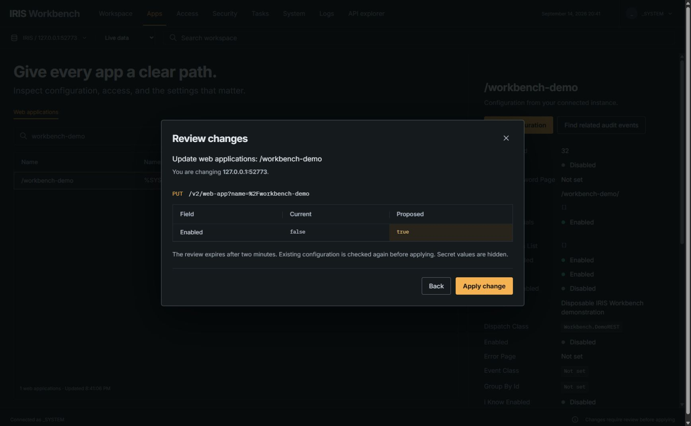
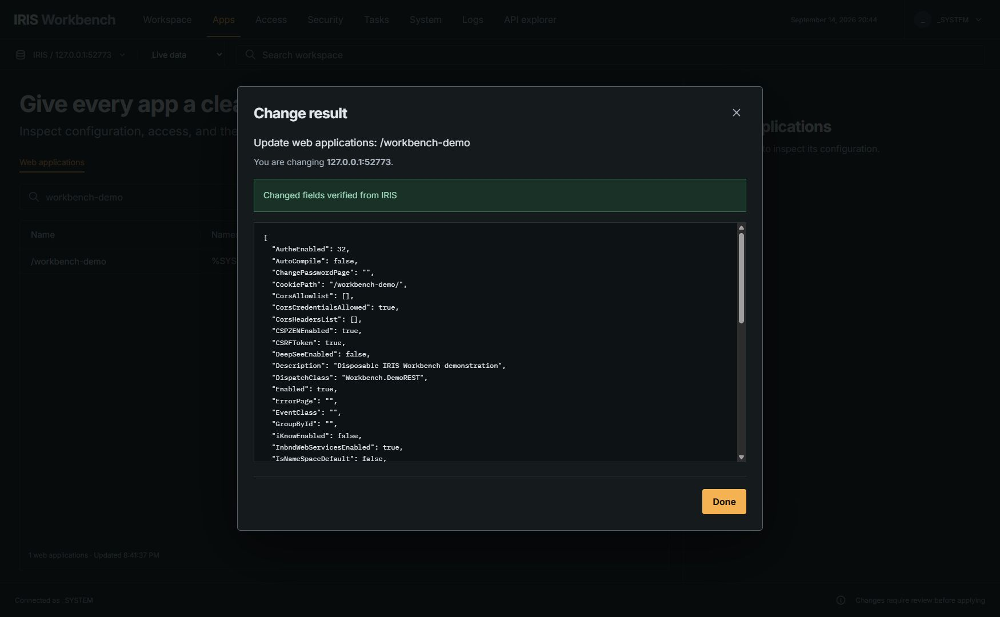

# Demonstration: bring a local service online

This is a real local IRIS workflow. The service is deliberately disposable, and sample design mode is not used. The demo script accepts only a local IRIS address (`127.0.0.1`, `localhost` or `::1`) and a local Workbench backend.

## Prepare

Choose the preparation path that matches your instance. Keep the backend running in its own terminal; run demo commands in a second terminal from the app directory. Set `WORKBENCH_URL` there if the backend port differs from 3411.

### Use a fresh local instance

Complete [fresh setup](README.md#create-a-fresh-local-instance) and start Workbench with `scripts/start-local.mjs`. Setup installs `Workbench.DemoREST` and configures the private credential file. Run these commands with the same private state directory used to start the backend:

```powershell
node scripts/demo.mjs setup "C:/path/to/private/workbench-state"
node scripts/demo.mjs check "C:/path/to/private/workbench-state"
```

On macOS or Linux, replace that path with your private state directory, keeping it quoted.

### Use an existing local instance

First follow the [existing-instance authentication prerequisites](README.md#run-with-your-existing-iris-instance) and install the extension, which includes `Workbench.DemoREST`. The browser's manual sign-in session is separate from the demo script's session. The script signs in through the backend's configured credential file for all three actions: setup, check and cleanup.

Create a private `credentials.json` outside the source directory using a local editor. Its JSON structure is:

```json
{
  "user": "YOUR_IRIS_USERNAME",
  "password": "YOUR_IRIS_PASSWORD"
}
```

Replace the placeholders locally with a valid account allowed to manage this disposable web application. Restrict the file's access to your operator account and keep it out of source control and support attachments.

Stop the Workbench Node process if it is already running. In the backend terminal, set both variables **before** starting it. In PowerShell:

```powershell
$env:IRIS_URL = 'http://127.0.0.1:52773'
$env:IRIS_CREDENTIALS_FILE = 'C:/path/to/private/credentials.json'
node server/index.mjs
```

On macOS or Linux:

```bash
export IRIS_URL='http://127.0.0.1:52773'
export IRIS_CREDENTIALS_FILE='/absolute/path/to/private/credentials.json'
node server/index.mjs
```

In a second terminal, set the same two variables for your shell and run the commands without a state-directory argument:

```powershell
node scripts/demo.mjs setup
node scripts/demo.mjs check
```

The backend and script must use the same local IRIS origin and credential file. Changing variables only in the demo terminal does not configure an already running backend.

Setup creates `/workbench-demo` disabled, with password authentication and `%Admin_Operate` access. It refuses to overwrite an existing application. Check sends an authenticated request to the local service and prints only its status and response, never credentials. The disabled service should return HTTP 404.

## Demonstrate the change

1. Open [local Workbench](http://127.0.0.1:3411), connect and select Live data.
2. Open Apps and filter for `workbench-demo`.
3. Select the application and inspect its namespace, dispatch class and disabled state.
4. Choose Edit configuration, change Enabled to true, then choose Review changes.
5. Check that the review contains the intended field. Apply the change.
6. Confirm the result reports that changed fields were verified from IRIS.
7. Run the same check command again. It should return HTTP 200 with `{"service":"Workbench demonstration","status":"ready"}`.
8. Open Workspace to inspect the session's applied change. Open Logs to inspect the actual instance's available evidence. Audit visibility depends on IRIS audit settings.

The demo separates a successful configuration write from a responding service. There is no invented availability score or automatic rollback.

## Show the rest of the portal

In Access, inspect users, roles and resources. In Security, inspect wallet collections, certificate metadata, TLS and OAuth configuration. In Tasks, inspect schedules and execution history. In System, inspect processes and capacity with explicit units. In Logs, switch sources, choose a rotation, load older events and return to the latest page. The read API explorer exposes the organizer's documented endpoints and preserves IRIS permission checks.

See [verification](VERIFICATION.md) for the representative lifecycle tests performed across these areas. A task run request was independently checked for actual execution, and role assignment was checked using the test user's actual access.

## Clean up

```powershell
node scripts/demo.mjs cleanup "C:/path/to/private/workbench-state"
```

For an existing local instance configured through environment variables, use `node scripts/demo.mjs cleanup` in the same demo terminal instead.

Cleanup verifies the demo application's identity before deleting it and checks that it is absent afterward. The class remains available for another demonstration. Existing applications are not modified.

## Recorded demonstration





See [HTTP before and after evidence](evidence/demo-service.json).
