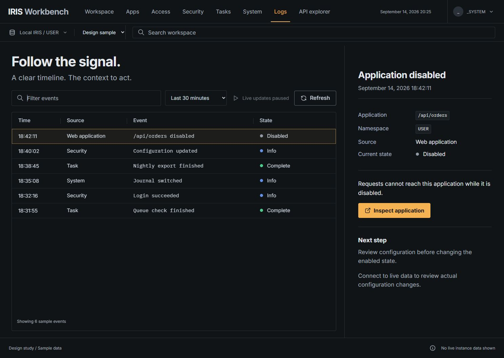

# IRIS Workbench

A local management portal for InterSystems IRIS. Inspect applications, follow events, review a change, and verify the result from the instance.

Run the Node backend on your own computer to connect to IRIS. A hosted preview shows the fictional design sample; it cannot connect to your instance or perform live management operations.

Built for the [InterSystems management portal contest](https://community.intersystems.com/post/intersystems-programming-contest-build-your-own-management-portal). Read the [project idea](IDEA.md), [demonstration](DEMO.md), [log coverage](LOGS.md), [verification record](VERIFICATION.md), and [design QA](design-qa.md).



Version 1.0.3. [MIT licensed](LICENSE). This is an independent community project, not an official InterSystems product.

## What works

1. Web application lists, configuration editing, creation and deletion with a review step.
2. Users, roles and resources, including role assignment and revocation.
3. Wallet collections and secrets, certificate import from paths on the IRIS server, certificate validity metadata, TLS configuration, OAuth server and client configuration.
4. Task definitions, creation, editing, run requests, suspension, resumption and history.
5. Processes and devices, controlled process suspension and resumption, CPU load, container and host memory, and disk capacity.
6. Runtime messages, audit events, task history, journal records, alerts and System Monitor logs, plus configured application text logs, file rotations, bounded gzip reads and older event paging.
7. A documented API explorer for reads and a session history of applied changes.

The design sample is explicitly fictional and does not write to IRIS. Live mode uses the actual connected instance. Read requests and changes run with the connected user's IRIS permissions.

## Requirements

All users need Node.js 24.19.0 or later and pnpm 11.19.0. Connecting to an existing IRIS instance does not require Docker on the Workbench computer.

Creating a fresh local instance, or using the Docker extension installer, also requires Docker running Linux containers: Docker Desktop on Windows or macOS, or Docker Engine on Linux. Windows 11 x64 with Chrome and Edge is the verified local operator platform. Fresh setup uses the verified IRIS Community 2026.2 image, pinned by digest. Allow at least 3 GB for the IRIS container, plus the host's normal overhead.

## Get the versioned source

Download `iris-workbench_1.0.3_source.zip` and `SHA256SUMS` from the [v1.0.3 release](https://github.com/agammann/iris-workbench/releases/tag/v1.0.3). This version includes the connection fixes, empty-response validation and null JSON read checks. The earlier v1.0.2 ZIP does not include the null-read follow-up. In PowerShell, check the ZIP before extracting:

```powershell
Get-FileHash .\iris-workbench_1.0.3_source.zip -Algorithm SHA256
Get-Content .\SHA256SUMS
Expand-Archive .\iris-workbench_1.0.3_source.zip -DestinationPath .\iris-workbench-v1.0.3
Set-Location .\iris-workbench-v1.0.3\iris-workbench-1.0.3
npm install --global pnpm@11.19.0
node --version
pnpm --version
```

On Linux, compare `sha256sum iris-workbench_1.0.3_source.zip` with `SHA256SUMS`; on macOS use `shasum -a 256 iris-workbench_1.0.3_source.zip`. After the hash matches:

```bash
unzip iris-workbench_1.0.3_source.zip -d iris-workbench-v1.0.3
cd iris-workbench-v1.0.3/iris-workbench-1.0.3
npm install --global pnpm@11.19.0
node --version
pnpm --version
```

The ZIP hash must match its line in `SHA256SUMS`; stop if it differs. The accompanying `release-manifest.json` identifies the exact source commit, tree, pinned Community image and API specification. The source ZIP contains the MIT license, frozen lockfile, backend and extension; it contains no private state or downloaded schema cache.

For a first try, use **Create a fresh local instance** below. For an instance you already manage, use **Run with your existing IRIS instance**. The design sample is fictional; selecting it does not establish a live connection. No hosted service, LLM or provider API key is required.

## Run with your existing IRIS instance

Workbench connects to the IRIS **web server** and signs in by sending HTTP Basic credentials to `GET /api/admin/info`. Before starting it, check these prerequisites in IRIS Management Portal:

1. Use an instance that exposes the sysadmin REST APIs in the [pinned specification](#api-specification-and-compatibility). The verified target is IRIS Community 2026.2; installing the Workbench extension does not install or upgrade `/api/admin`.
2. Under **System Administration → Security → Applications → Web Applications**, open `/api/admin`. Confirm that it is enabled and **Password** is allowed as an authentication method. If Password is unavailable there, check **System Administration → Security → System Security → Authentication/Web Session Options → Allow Password authentication**, as described in the [system-wide authentication options](https://docs.intersystems.com/irislatest/csp/docbook/DocBook.UI.Page.cls?KEY=ROARS_iam_instanceauthn). Preserve the application's existing dispatch class, namespace, required resource and other authentication methods. Follow the official [web application authentication settings](https://docs.intersystems.com/irislatest/csp/docbook/DocBook.UI.Page.cls?KEY=GSA_manage_applications).
3. Use an enabled IRIS account with a valid password and permission for the management operations you intend to perform. `%ALL` grants privileges after authentication; it does not bypass a disabled application, a disallowed authentication method or invalid credentials. Check the [user account settings](https://docs.intersystems.com/irislatest/csp/docbook/DocBook.UI.Page.cls?KEY=GSA_config_user_accounts) if the account cannot sign in.

From this directory, in PowerShell:

```powershell
pnpm install --frozen-lockfile
node scripts/fetch-spec.mjs
pnpm run build
$env:IRIS_URL = 'http://127.0.0.1:52773'
node server/index.mjs
```

On macOS or Linux:

```bash
pnpm install --frozen-lockfile
node scripts/fetch-spec.mjs
pnpm run build
export IRIS_URL='http://127.0.0.1:52773'
node server/index.mjs
```

Set `IRIS_URL` to the origin of that web server, including its web port: for example `http://127.0.0.1:52773` or `https://iris.example.com`. Do not append `/api/admin`, `/csp/sys` or another path, and do not use the IRIS superserver port (commonly 1972). Workbench adds the API paths itself. Set the environment variables in the same terminal **before** starting Node; restart the backend after changing them.

Open [IRIS Workbench](http://127.0.0.1:3411). Enter an existing IRIS username and password in the connection form. The password remains in server memory for a one hour session and is never returned to the client. Sign out to remove the session. For a remote instance use HTTPS; the server rejects remote plaintext connections.

If connection fails, open a second terminal, set `IRIS_URL` to the same origin used by the running backend, and test the same endpoint and account directly. On Windows use `curl.exe` to avoid PowerShell's `curl` alias:

```powershell
curl.exe --user YOUR_USERNAME --include "${env:IRIS_URL}/api/admin/info"
```

On macOS or Linux use `curl --user YOUR_USERNAME --include "$IRIS_URL/api/admin/info"`. Both commands prompt for the password; do not put it in the command or share the response body. HTTP 200 with JSON instance information containing nonempty `username` and `serverVersion` strings confirms this sign-in endpoint works; an HTML page is not a successful API response. HTTP 401 means that IRIS or its web gateway rejected authentication; check the prerequisites above and any proxy's handling of the Authorization header. See [connection diagnostics](docs/operations.md#connection-diagnostics) for other responses and for expired Workbench sessions.

To enable runtime log and capacity views in a local Docker instance, run the installer from the source directory in a second terminal. Select the container that serves your configured `IRIS_URL` explicitly. In PowerShell:

```powershell
$env:IRIS_CONTAINER = 'your-iris-container'
node scripts/install-iris.mjs
```

On macOS or Linux:

```bash
export IRIS_CONTAINER='your-iris-container'
node scripts/install-iris.mjs
```

The installer loads the supplied classes into `%SYS` and creates or updates `/api/workbench`, using password authentication and `%Admin_Operate` access. It does not modify `/api/admin` or its authentication settings; the sign-in prerequisites above must already be satisfied.

For a non Docker Linux installation, import and compile all three supplied classes in `iris/Workbench` into `%SYS`, and copy `iris/workbench_logs.py` to `workbench/workbench_logs.py` under the active IRIS manager directory. In Management Portal, create or update the `/api/workbench` web application with these settings:

| Setting | Value |
| :--- | :--- |
| Namespace | `%SYS` |
| Application type | REST |
| Dispatch Class | `Workbench.Runtime` |
| Enable Application | Yes |
| Allowed Authentication Methods | Password |
| Resource Required | `%Admin_Operate` |

These settings apply to `/api/workbench`; preserve the built-in `/api/admin` dispatch class, namespace and resource. The text reader and capacity collector target Linux IRIS instances. The Windows host used for this project runs IRIS in a Linux Docker container.

## Create a fresh local instance

Choose an unused local port and an empty private state directory outside the repository. Replace the example state path with your own. The setup refuses to overwrite an existing container or credential file. In PowerShell:

```powershell
pnpm install --frozen-lockfile
node scripts/fetch-spec.mjs
pnpm run build
$env:IRIS_CONTAINER = 'iris-workbench-local'
$env:IRIS_PORT = '52773'
$env:WORKBENCH_STATE_DIR = 'C:/path/to/private/workbench-state'
node scripts/setup-local.mjs
node scripts/start-local.mjs "$env:WORKBENCH_STATE_DIR"
```

Setup creates a new Community container, generates a random local administrator credential, verifies authenticated access to `/api/admin/info`, installs the extension, and verifies a runtime log read. The generated credential is stored only in your private state directory. The database itself stays inside this new container; the state directory is connection information, not a database backup. The portal offers **Connect local instance** for this configuration. Do not include that directory in source control, archives or support reports.

On macOS or Linux:

```bash
pnpm install --frozen-lockfile
node scripts/fetch-spec.mjs
pnpm run build
export IRIS_CONTAINER='iris-workbench-local'
export IRIS_PORT='52773'
export WORKBENCH_STATE_DIR='/absolute/path/to/private/workbench-state'
node scripts/setup-local.mjs
node scripts/start-local.mjs "$WORKBENCH_STATE_DIR"
```

Leave the server terminal running and open [IRIS Workbench](http://127.0.0.1:3411), then choose **Connect local instance**. For later restarts, run `node scripts/start-local.mjs` with the same private state directory; do not rerun setup against the existing container.

## Upgrade, recovery and support

Keep the previous source folder and the private state directory when upgrading Workbench. Stop only its Node process, install and build the new source in another directory, then restart it with the same connection file. An app upgrade does not recreate your IRIS container. Follow [operations and recovery](docs/operations.md) for extension updates, partial setup, database backups and removal boundaries.

For help, use the [issue tracker](https://github.com/agammann/iris-workbench/issues) with the Workbench and Node/pnpm versions, IRIS version, Docker version and image digest when applicable, affected view, expected result and sanitized error. Omit credentials, wallet values, certificates/private keys, raw instance logs and your private state directory. See [contributing](CONTRIBUTING.md) and [security reporting](SECURITY.md).

## Development

Keep the backend running on port 3411, then run `pnpm dev` for the Vite frontend at [port 5173](http://127.0.0.1:5173). Vite proxies the portal API to the backend. The production command `node server/index.mjs` serves the built client and backend together. Ports bind to loopback by default.

```powershell
pnpm test
pnpm run build
pnpm run test:sites
pnpm audit
```

`pnpm test` covers request boundaries and setup failures. To exercise the log reader inside a running IRIS container, select that container explicitly:

```powershell
$env:IRIS_CONTAINER = 'your-iris-container'
pnpm run test:logs
```

The log checks create temporary fixtures under `/tmp/workbench-verification` in the selected container. The Python helper needs Linux directory file descriptors; run its tests in the chosen Linux container, not directly on Windows. A missing Docker executable or failed Docker command causes the check to fail.

For contributors using a Git checkout, check a committed release package without creating a container:

```powershell
pnpm package:release
pnpm test:consumer
```

Packaging requires Git and a clean committed source tree. The downloaded source ZIP has no `.git` directory; use it to run, build and test the app, and use a Git checkout for `package:release` and `test:consumer`. Python 3.12 is required by the archive verifier. The extracted consumer installs with the frozen lockfile, downloads and verifies the pinned schema, builds and runs the Node and static packaging tests. CI runs this on Linux and Windows, and runs the Linux log-reader suite separately. A live instance walkthrough remains a separate check; these package tests do not create or modify IRIS.

## Demonstration workflow

Watch the [captioned live screencast](https://github.com/agammann/iris-workbench/releases/download/v1.0.3/iris-workbench_1.0.3_screencast.mp4). It records the released v1.0.3 app against a disposable IRIS Community 2026.2 instance: review and apply the `Enabled` change, verify IRIS readback, then check the independent HTTP response. The video is silent with subtitles; its response annotation is a recording aid.

Follow [DEMO.md](DEMO.md) to create a disposable REST service, observe its HTTP 404 while disabled, enable it through the browser review flow, and verify HTTP 200 with a real JSON response. The script refuses to overwrite an existing application and provides an identity checked cleanup command.

For a local live-instance retest, first confirm `/api/admin/info` returns HTTP 200 with JSON instance information, connect to Workbench and select **Live data**, then run this demonstration. It supplies a real application and an observable configuration change beyond the available logs. The demo script supports local IRIS only and requires the installed `Workbench.DemoREST` class plus a configured private credential file; fresh setup supplies both. Follow the [existing-instance demo prerequisites](DEMO.md#use-an-existing-local-instance) if you started with manual sign-in. Use an instance you manage and may create a disposable application on; fictional design sample data does not verify IRIS access.

The walkthrough also explains how to inspect the other five management areas. See the [verification record](VERIFICATION.md) for actual permission, task execution, process control and security lifecycle evidence.

## Operational boundaries

The portal is intended for a local operator, with one configured IRIS instance per server process. It is not a public multiuser hosted service. Public static hosting alone cannot run its Node backend or connect to your local IRIS instance.

Reviews expire after two minutes and existing objects are checked immediately before writes. This is a best effort conflict check, not an atomic transaction across the read and write. Result text distinguishes accepted operations from field readback. There is no automatic rollback.

Secret retrieval endpoints are blocked in the explorer, and structured sensitive fields are redacted in responses and reviews. Logs can contain application supplied text; this is not a universal log redaction service. Session history is held in memory and disappears on server restart. IRIS audit settings determine durable auditing.

Log reads are bounded. Uncompressed text files page backward in windows of at most 256 KiB and 200 lines. The source catalogue supports the configured console location, rotations, small gzip archives and explicitly configured application text logs. Alerts may be absent until IRIS creates the file. See [LOGS.md](LOGS.md) for exact limits and configuration. Optional binary subsystem formats, Windows event logs and interoperability message bodies are outside the text reader; do not advertise universal access to every IRIS log.

OAuth configuration tests do not establish successful authorization with a real identity provider. Certificate import uses file paths on the IRIS host; browser file uploads are not implemented. Process suspension and resumption were verified on a disposable Workbench process; existing system processes were not changed.

## API specification and compatibility

The app uses the organizer's [API specification](https://github.com/intersystems-community/sysadmin-api-specification), pinned to commit `f764aea427e5c0b1dd08a4c18a0457e0ff7b3b34`. The download script checks its SHA256 digest. The upstream schema is a local cache excluded from source archives. The adapter corrects the OAuth client field `OAuth2ServerDefinition` to the observed `ServerDefinition` accepted by the verified IRIS 2026.2 implementation.

See [third party notices](THIRD-PARTY-NOTICES.md). The project source is provided under the [MIT license](LICENSE). Open Exchange moderation and contest acceptance are separate from source publication. See [release status](RELEASE.md) for the recorded delivery state.

## Troubleshooting

| Symptom | Action |
| :--- | :--- |
| Could not connect to IRIS | Confirm `IRIS_URL` is the correct web server origin, the instance is reachable and the direct `/api/admin/info` check succeeds. Restart Node after changing environment variables. See [connection diagnostics](docs/operations.md#connection-diagnostics). |
| IRIS sign-in returns HTTP 401, even with `%ALL` | Check `/api/admin` is enabled and allows Password authentication, the account is enabled and its password is valid. The extension installer only configures `/api/workbench`. |
| Workbench asks to reconnect after previously working | Its one hour session may have expired, or the backend restarted. Reconnect; a local session failure is distinct from an IRIS authentication rejection. |
| Runtime extension HTTP error | Run the installer against the intended container. Confirm all three classes compiled and the helper file is present. `%Admin_Operate` is required for extension reads. |
| A view returns Forbidden | Workbench uses the connected user's IRIS permissions. Sign in with an appropriately authorized account; the portal does not grant itself privileges. |
| Older log page says the file changed | Select Latest events to start from the new file state. |
| A configured log is absent | Check its path inside the IRIS container, file permissions and LOGS.md. Select Reload sources. |
| Task does not run immediately | A run request can wait for the next scheduler tick. Inspect task history for actual execution. |
| Port 3411 is occupied | Set `PORT` before starting the production server. For frontend development, update the Vite proxy consistently. |
| Missing server/spec.json | Run `node scripts/fetch-spec.mjs`. The cache is intentionally excluded from source control. |
